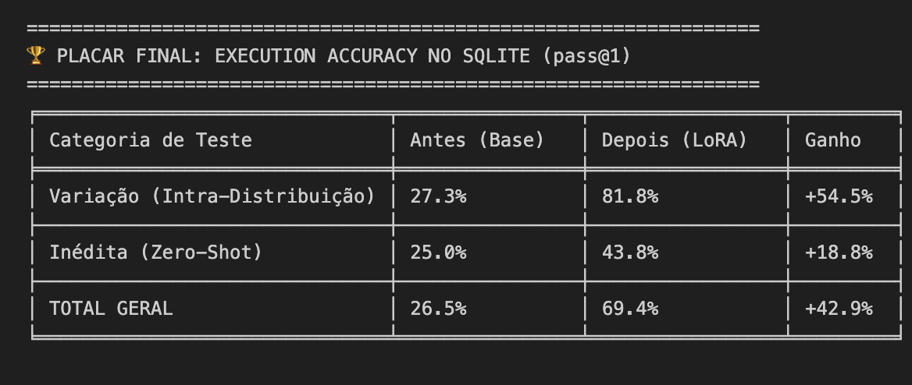
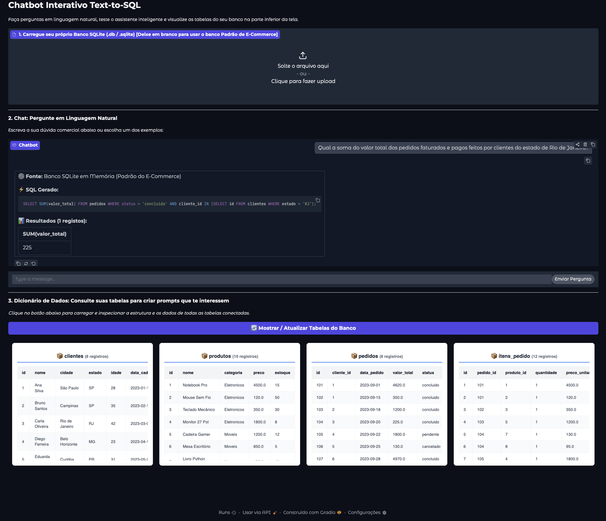

# Fine-Tuning de LLMs para Text-to-SQL: Qwen2.5-Coder-7B com LoRA

## Integrantes
- Victor Kenzo Toma - RM: 551649
- Arthur Baldissera Claumann Marcos - RM: 550219
- Ricardo Ramos Vergani - RM: 550166

## Descrição do Projeto
Este projeto implementa o treinamento (fine-tuning) de um Modelo de Linguagem de Grande Escala (LLM) para a tarefa de Text-to-SQL. O objetivo principal é ensinar o modelo a receber o esquema de um banco de dados relacional e uma pergunta em linguagem natural, traduzindo jargões de negócio específicos de uma empresa em consultas SQL sintática e semanticamente válidas.

A arquitetura base utiliza o modelo aberto **Qwen2.5-Coder-7B**, que possui aproximadamente 7.61 bilhões de parâmetros e foi pré-treinado em mais de 5.5 trilhões de tokens de código e SQL. Para viabilizar o treinamento local de forma eficiente, aplicamos a técnica **LoRA (Low-Rank Adaptation)**, que congela os pesos originais do modelo e treina apenas cerca de 0.25% dos parâmetros, preservando o conhecimento prévio e economizando memória.

## Requisitos de Hardware
Para reproduzir este projeto, é necessário observar o consumo de memória de vídeo (VRAM) ou memória unificada devido ao tamanho do modelo de 7 bilhões de parâmetros.

- **Hardware Mínimo Necessário:**
  - Aproximadamente 15 GB de VRAM para alocar os pesos do modelo em precisão `float16` ou `bfloat16`.
  - Cerca de 5 GB de VRAM adicionais para armazenar os gradientes e estados do otimizador AdamW durante o treinamento com LoRA.
  - **Total Mínimo:** 20 GB de VRAM / Memória Unificada.

- **Hardware Utilizado no Treinamento:**
  - CPU: M5 pro.
  - Aceleração: MPS (Metal Performance Shaders) ativo em precisão `float16`.
  - Memória: 48 GB de Memória Unificada (com ampla sobra para aumentar o batch size e evitar erros de falta de memória - OOM).

## Instalação e Dependências
As bibliotecas utilizadas para manipulação de dados, treinamento deep learning e interface gráfica estão listadas no arquivo `requirements.txt`.

Execute o comando abaixo para instalar todas as dependências:

```bash
pip install -r requirements.txt
```

Principais pacotes utilizados:
- `torch>=2.0.0`
- `transformers>=4.40.0`
- `accelerate>=0.28.0`
- `peft>=0.10.0`
- `datasets>=2.18.0`
- `pandas>=2.0.0`
- `gradio>=4.0.0`

## Estrutura do Pipeline
O fluxo de desenvolvimento contido no notebook está dividido nas seguintes etapas funcionais:

1. **Setup e Inicialização:** Detecção de hardware (CUDA/MPS) e carregamento do modelo Qwen2.5-Coder-7B em 16 bits.
2. **Banco de Dados Relacional:** Criação de um ambiente SQLite em memória contendo as tabelas do E-Commerce (clientes, produtos, pedidos, itens_pedido).
3. **Engenharia de Dados Sintéticos:** Geração de um dataset com 66 exemplos de treino e 49 exemplos de teste, mapeando termos comerciais (ex: "linha premium") para regras matemáticas de banco de dados (ex: "preco > 1000.0").
4. **Avaliação Baseline:** Medição da Execution Accuracy do modelo original, resultando em um acerto de 26.5% no conjunto de teste devido à falta de contexto corporativo.
5. **Configuração LoRA e Treinamento:** Injeção de matrizes de baixo rank (r=16) nas camadas de atenção, treinando por 2 épocas utilizando mascaramento de prompt (labels -100) para focar apenas na geração da query SQL.
6. **Avaliação Pós-Treinamento:** Reavaliação funcional do modelo adaptado com os novos pesos.
7. **Interface Gráfica:** Implementação de um aplicativo web com Gradio que permite o upload de bancos de dados SQLite personalizados, inspeção visual de tabelas via DataFrames e interação com o modelo via chat.

## Resultados Alcançados
A métrica utilizada para validação foi o **Execution Accuracy (pass@1)**, que executa a query gerada pelo modelo diretamente no banco SQLite e compara os registros retornados com o gabarito esperado.

Após o treinamento, o modelo demonstrou uma excelente capacidade de generalização e absorção de regras de negócio corporativas:




## Como Executar a Interface Interativa
No final do notebook, a aplicação web do Gradio é instanciada. Através dela, é possível:

1. Fazer upload de um arquivo `.db` ou `.sqlite` externo.
2. Clicar no botão para visualizar a estrutura e os registros de todas as tabelas em HTML.
3. Conversar com o assistente inteligente na janela de chat, enviando comandos em português e recebendo o código SQL gerado juntamente com a tabela de resultados do banco.


## Front-end no Gradio

